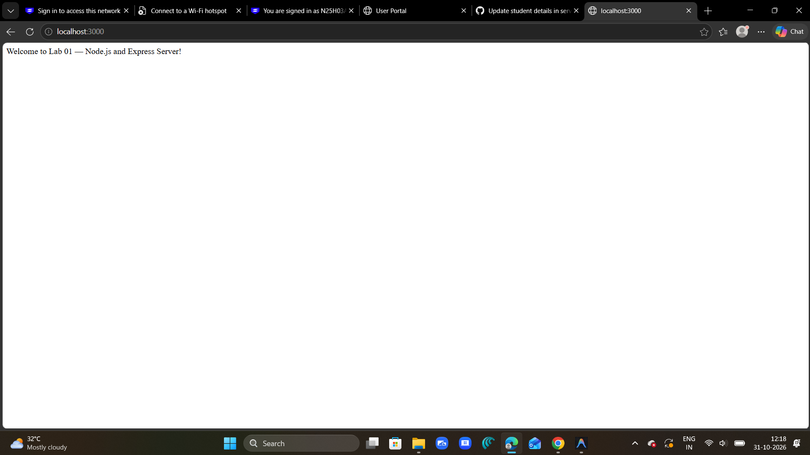
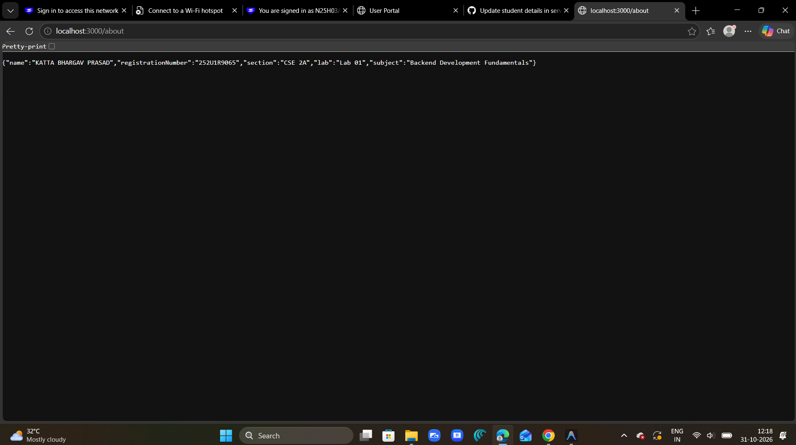
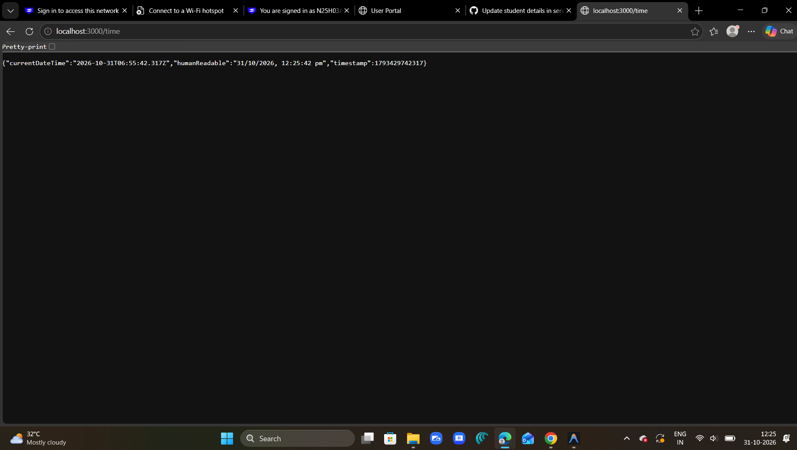

# Lab 01 — Node.js and Express Server

> **Subject:** Backend Development Fundamentals  
> **Module:** Node.js and Express.js Fundamentals  
> **Academic Year:** Year II, Term II  
> **Duration:** ~100 minutes  

---

## 👤 Student Information

| Field               | Details                  |
|---------------------|--------------------------|
| **Name**            | KATTA BHARGAV PRASAD     |
| **Registration No** | 252U1R9065               |
| **Section**         | CSE 2A                   |
| **Lab Number**      | Lab 01                   |

---

## 🌐 Live Deployment URL

> 🔗 [https://your-app-name.onrender.com](https://your-app-name.onrender.com)  
> *(Replace this with your actual Render URL after deployment)*

---

## 🎯 Project Objective

The objective of this lab is to:
- Understand what Node.js is and how it works as a backend runtime.
- Learn how to create a basic HTTP server using Node.js's built-in `http` module.
- Rewrite the server using Express.js for cleaner, more readable code.
- Implement multiple routes that return different types of responses (plain text, JSON, date/time).
- Handle unknown routes with a proper 404 response.
- Learn about HTTP status codes, request/response objects, and REST conventions.

---

## 🛠️ Technologies Used

| Technology      | Version  | Purpose                              |
|-----------------|----------|--------------------------------------|
| Node.js         | v18+     | JavaScript runtime environment       |
| Express.js      | ^5.3.0   | Web framework for Node.js            |
| npm             | v9+      | Package manager                      |
| Git             | Latest   | Version control                      |
| Render          | —        | Cloud deployment platform            |

---

## 📁 Project Structure

```
backend-development-labs/
├── README.md                ← Main repository documentation
├── screenshots/             ← Lab screenshots
└── lab-01/
    ├── screenshots/
    │   ├── welcome.png      ← Browser showing GET /
    │   ├── about.png        ← Browser showing GET /about
    │   ├── time.png         ← Browser showing GET /time
    │   └── not-found.png    ← Browser showing 404 response
    ├── .gitignore           ← Excludes node_modules and .env
    ├── package.json         ← Project metadata and scripts
    ├── package-lock.json    ← Locked dependency versions
    ├── server.js            ← Main Express server (entry point)
    └── README.md            ← Lab 01 specific documentation
```

---

## ⚙️ Installation Instructions

Follow these steps exactly to run this project on your local machine:

### Prerequisites
Make sure you have the following installed:
- [Node.js](https://nodejs.org) (v18 or higher)
- npm (comes bundled with Node.js)

### 1. Clone the Repository
```bash
git clone https://github.com/kattabhargavprasad-blip/backend-development-01.git
```

### 2. Navigate to the Lab Folder
```bash
cd backend-development-01/lab-01
```

### 3. Install Dependencies
```bash
npm install
```

### 4. Start the Server
```bash
npm start
```

---

## ▶️ Commands Reference

| Command         | What It Does                              |
|-----------------|-------------------------------------------|
| `npm init -y`   | Creates `package.json` automatically      |
| `npm install express` | Installs Express and saves it to `dependencies` |
| `npm start`     | Runs `node server.js` (defined in scripts)|
| `node server.js`| Directly runs the server                  |
| `Ctrl + C`      | Stops the running server                  |

---

## 🔌 API Endpoint Documentation

| Method | Endpoint  | Description                    | Status Code |
|--------|-----------|--------------------------------|-------------|
| GET    | `/`       | Returns a welcome message      | 200 OK      |
| GET    | `/about`  | Returns student name & section | 200 OK      |
| GET    | `/time`   | Returns current date and time  | 200 OK      |
| ANY    | `/*`      | Unknown route — not found      | 404 Not Found |

### Endpoint Details

#### `GET /`
```
Request:  GET http://localhost:3000/
Response: "Welcome to Lab 01 — Node.js and Express Server!"
Status:   200 OK
```

#### `GET /about`
```json
{
  "name": "KATTA BHARGAV PRASAD",
  "registrationNumber": "252U1R9065",
  "section": "CSE 2A",
  "lab": "Lab 01",
  "subject": "Backend Development Fundamentals"
}
```
Status: `200 OK`

#### `GET /time`
```json
{
  "currentDateTime": "2026-10-30T05:32:30.000Z",
  "humanReadable": "10/30/2026, 11:02:30 AM",
  "timestamp": 1762040550000
}
```
Status: `200 OK`

#### Unknown Route
```
Request:  GET http://localhost:3000/anything-else
Response: "404 - Page Not Found"
Status:   404 Not Found
```

---

## 📸 Screenshots

### GET / — Welcome Route


### GET /about — About Route


### GET /time — Time Route


### Unknown Route — 404


---

## ⚠️ Problems Faced and Solutions

| Problem                                      | Solution                                                    |
|----------------------------------------------|-------------------------------------------------------------|
| `Cannot find module 'express'`               | Ran `npm install express` to install the dependency         |
| Port 3000 already in use                     | Changed port to 3001 or killed the existing process         |
| 404 handler was catching valid routes        | Moved the 404 handler to the very end of the file           |
| `process.env.PORT` was `undefined` locally   | Used `process.env.PORT \|\| 3000` as a fallback             |

---

## 🚀 Deployment (Render)

This project is deployed using [Render](https://render.com).

| Setting        | Value                                         |
|----------------|-----------------------------------------------|
| Service Type   | Web Service                                   |
| Root Directory | `lab-01`                                      |
| Build Command  | `npm install`                                 |
| Start Command  | `npm start`                                   |
| Environment    | Node                                          |
| Public URL     | https://your-app-name.onrender.com            |

---

## ✅ Conclusion

In this lab, I successfully:
- Set up a Node.js project from scratch using `npm init`.
- Installed and used Express.js to build a web server.
- Created four routes: `/`, `/about`, `/time`, and a 404 catch-all.
- Learned the difference between plain-text and JSON responses.
- Applied correct HTTP status codes (200, 404).
- Pushed the code to GitHub and deployed it using Render.

---

*Lab 01 | Backend Development Fundamentals | Year II, Term II*
